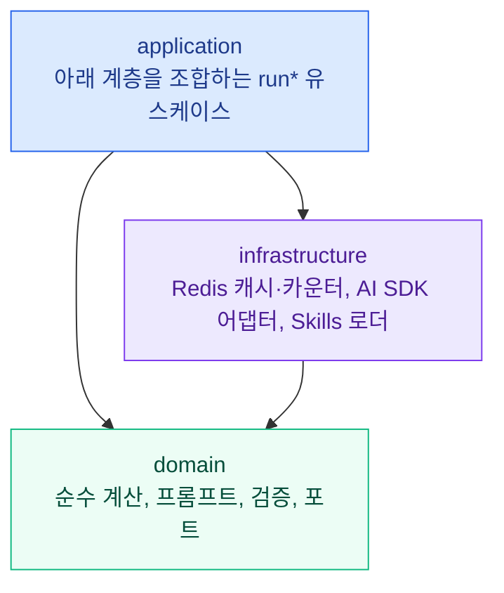

# SIGLENS CORE

<div align="center">

**주식·암호화폐 기술적 분석을 위한 TypeScript 라이브러리. 보조지표, 캔들·차트 패턴, 매매 신호, 검증된 AI 분석을 제공합니다.**

[](./LICENSE)
[](./package.json)

[](https://siglens.io)
[](https://github.com/y0ngha/siglens)
[](./README.md)

</div>

---

`@y0ngha/siglens-core`는 미국 주식·한국 주식·비트코인 등 암호화폐를 다루는 AI 주식 분석 서비스 [SIGLENS](https://siglens.io)의 분석 엔진을 공개한 오픈소스 라이브러리입니다. 가격 봉 데이터만 넣으면 RSI·MACD·볼린저 밴드 같은 보조지표를 계산하고, 캔들 패턴과 차트 패턴을 찾고, 골든크로스 같은 매매 신호와 공포·탐욕 지수를 만듭니다. AI 분석에 쓸 프롬프트도 만들고, AI가 내놓은 답변은 사용자에게 보여 주기 전에 검증합니다.

> **투자 조언이 아니며, 주문·매매 기능은 없습니다.** 분석 결과를 만들 뿐입니다.

## 어떤 패키지인가요

주식 차트 분석, 즉 차트가 무엇을 뜻하는지 판단하는 데 필요한 것을 모두 담고 있습니다. 보조지표를 어떻게 계산하는지, 어떤 패턴과 신호가 나타났는지, AI 프롬프트를 어떻게 구성하는지, 모델의 답변을 어떻게 검증하는지가 여기에 있습니다. UI도, React도, Next.js도 없는 순수 TypeScript 라이브러리입니다. [SIGLENS 웹 앱](https://github.com/y0ngha/siglens), 백그라운드 워커(웹 서버 밖에서 작업을 돌리는 별도 프로세스), [ai.siglens.io](https://ai.siglens.io)의 AI 에이전트가 모두 이 패키지를 쓰므로, 어디서 쓰든 계산 결과와 규칙이 같습니다.

## 빠른 시작

```ts
import { calculateIndicators, detectSignals, type Bar } from '@y0ngha/siglens-core';

// 오래된 봉이 앞에 옵니다. `time`은 초 단위 Unix 타임스탬프입니다.
const bars: Bar[] = [{ time: 1_735_689_600, open: 189.2, high: 191.0, low: 188.1, close: 190.4, volume: 48_200_000 } /* , ... */];

const indicators = calculateIndicators(bars); // 봉마다 RSI, MACD, 볼린저 밴드 ...
const signals = detectSignals(bars, indicators); // 예: { type: 'golden_cross', direction, phase, detectedAt }
```

계산에 필요한 봉이 모자란 앞부분은 `null`로 채워져, "아직 계산 불가"와 진짜 `0`이 헷갈리지 않습니다.

## 결과를 얼마나 믿을 수 있나요

- **숫자는 AI가 아니라 코드가 계산합니다.** 보조지표, 신호, 패턴, 점수표는 순수 함수가 같은 입력에 항상 같은 값을 내도록 계산합니다. AI는 이미 계산된 숫자를 해석할 뿐입니다.
- **AI의 답변은 검증합니다.** 응답은 JSON 복구, 정규화, 정합성 검사를 거치고, 앞뒤가 맞지 않는 답변은 보여 주는 대신 고치거나 거부합니다. 코드로 강제하는 예를 들면, 가격이 0 이하이거나 근거 설명이 비어 있는 지지선·저항선은 버리고, AI가 낸 손절가·목표가는 ATR 기반 보정값과 함께 검증합니다. AI 답변 속 숫자가 AI에게 준 도구 결과 어디에도 없으면 걸러 내는 도구도 있습니다.
- **그래도 틀릴 수 있습니다.** AI는 차트를 잘못 읽을 수 있고, 과거에 맞은 신호가 앞으로도 맞는다는 보장은 없습니다.

## 할 수 있는 일

### 보조지표

가격 봉 배열 하나로 다양한 보조지표를 계산해 하나의 구조화된 결과로 돌려줍니다. 추세·모멘텀·변동성·거래량 계열을 모두 다루며 이동평균, RSI, MACD, 볼린저 밴드, 일목균형표, 슈퍼트렌드, 스마트 머니 컨셉, 스퀴즈 모멘텀 등이 포함됩니다. 계산은 외부 지표 라이브러리 없이 패키지 안에서 직접 구현했습니다.

### 캔들·차트 패턴

단봉과 다봉 캔들 패턴(망치형, 도지, 장악형, 하라미 등)은 봉 데이터에서 바로 감지합니다. 규모가 큰 차트 패턴(헤드앤숄더, 이중·삼중 천장과 바닥, 삼각수렴, 쐐기, 플래그, 컵앤핸들 등)은 먼저 기하학적 형태로 후보를 거르고, 패턴으로 인정할 조건을 확인한 뒤 겹치는 후보끼리 우열을 가려 그럴듯한 형태만 차트나 AI 프롬프트에 올립니다. 추세선, 지지선·저항선, 피보나치 되돌림 레벨, 다이버전스, 엘리어트 파동 후보도 같은 데이터에서 만들 수 있습니다.

### 신호 감지

순수 함수 감지기가 보조지표의 상태를 이름 붙은 신호로 바꿉니다. 골든크로스·데드크로스, RSI 과매수·과매도, MACD 교차, 볼린저 밴드 돌파처럼 확정된 신호와, 움직임이 완성되기 전에 나타나는 RSI 다이버전스·볼린저 스퀴즈·지지선/저항선 접근 같은 선행 신호, 눌림목, 추세 분류가 여기에 해당합니다. 여러 신호가 같은 방향을 가리키는지(합류, confluence)도 따로 점검합니다.

### Skills

Skills는 코드가 아니라 frontmatter가 붙은 Markdown 파일로 쓴 분석 기법입니다. 패키지는 이 파일을 읽고, 시장 상태에 맞게 골라 걸러 낸 뒤 프롬프트에 넣습니다. 새 기법은 파일 하나를 추가하면 되고 계산 코드는 건드리지 않습니다. Skill 파일 자체는 사용하는 쪽에서 제공합니다.

### AI 분석 프롬프트와 검증

기술적 분석, 펀더멘털, 재무, 뉴스, 옵션(파생상품) 시장, 미국 의회 의원들의 주식 거래, 투자자 수급, 종합 분석은 물론 시장·거시경제 브리핑까지 프롬프트를 순수 함수로 구성합니다. 모델 레지스트리에는 Anthropic, Google, OpenAI, DeepSeek의 지원 모델이 정리되어 있습니다.

### 분석 유스케이스

`runAnalysis`, `runOverallAnalysis`, `runNewsAnalysis`, `runBriefing` 같은 `run*` 함수는 같은 프로세스 안에서 모델을 직접 호출해 완성된 결과를 돌려줍니다. 캐시, 같은 요청의 동시 실행 중복 제거, 티어별 이용 제한과 사용량 제한, BYOK까지 처리합니다. *티어*는 서비스 요금제(free, member, pro)이고, *BYOK*(bring your own key)는 사용자가 자기 AI API 키를 직접 넣는 방식입니다. 재분석 쿨다운(종목·타임프레임별 5분)은 사용하는 쪽이 가져다 쓰는 헬퍼로 제공합니다. 작업 큐나 외부 워커는 없습니다.

### 시장 심리

공포·탐욕 지수는 0~100점으로 계산하고 극단적 공포, 공포, 중립, 탐욕, 극단적 탐욕의 5단계로 나눕니다. 개별 종목, 미국 시장 전체, 암호화폐 각각에 대해 계산하며 백분위와 국면별 통계를 함께 제공합니다. 극단 구간에 머문 기록(시작일·종료일·머문 기간·최고 점수)을 정리하고, 같은 날 종목 점수와 시장 점수의 차이를 비교하는 도구도 있습니다. 코스피·코스닥 호가 단위에 맞춰 가격을 반올림하는 함수도 있습니다.

### 에이전트 구성 요소

대화형 에이전트를 위한 도구 목록, 인자 검증, 시스템 프롬프트, 대화 이력 창, 그리고 단계 상한·중단·환불을 갖춘 턴 루프를 제공합니다.

## 구조



- **domain**은 I/O도, 시계도, 환경 변수 접근도 없는 순수 TypeScript입니다. 캐시, 시세, 뉴스, 저장소처럼 외부 세계가 만족해야 할 포트도 여기서 선언합니다.
- **infrastructure**는 Upstash Redis, AI 제공사 SDK, Skills 파일 읽기처럼 바깥과 통신합니다. domain만 import할 수 있습니다.
- **application**은 위 두 계층을 엮어 처음부터 끝까지 이어지는 유스케이스를 만듭니다. 아래 계층은 application을 import하지 않습니다.

진입점은 두 개입니다. 서버 진입점(`dist/index.js`)은 전체 API를 내보냅니다. 번들러는 `browser` export 조건에 따라 브라우저 진입점(`dist/index.client.js`)을 고르며, 이쪽은 application·infrastructure 런타임 코드가 빠진 순수한 브라우저 안전 부분집합입니다. deep import는 지원하지 않습니다. 화면, 데이터베이스 어댑터, 포트를 구현하는 시세 조회 코드는 사용하는 쪽이 맡습니다.

## 설치

GitHub Packages에 배포되어 있습니다. `@y0ngha` 스코프를 해당 레지스트리에 연결하고, `read:packages` 권한이 있는 GitHub 토큰으로 인증해야 합니다. CI를 포함해 설치할 때마다 토큰이 필요합니다.

```yaml
# .yarnrc.yml
npmScopes:
    y0ngha:
        npmRegistryServer: 'https://npm.pkg.github.com'
        npmAuthToken: '${GITHUB_TOKEN}'
```

```ini
# .npmrc
@y0ngha:registry=https://npm.pkg.github.com
//npm.pkg.github.com/:_authToken=${GITHUB_TOKEN}
```

```bash
yarn add @y0ngha/siglens-core
```

Node.js 22 이상이 필요합니다. `@upstash/redis`는 선택적 peer dependency이며, Redis 기반 캐시·카운터를 쓸 때만 설치하면 됩니다.

## 실행 환경 설정

**시세 데이터는 포함되어 있지 않습니다.** `MarketDataProvider` 포트(`getBars`, `getQuote`)를 직접 구현해, 봉을 가져오는 유스케이스(`runAnalysis` 등)에 `marketDataProvider`로 넘겨야 합니다.

infrastructure 계층은 해당 기능을 쓸 때만 아래 환경 변수를 읽습니다.

| 변수 | 용도 | 필수 여부 |
|---|---|---|
| `ANTHROPIC_API_KEY`, `GEMINI_API_KEY`, `OPENAI_API_KEY`, `DEEPSEEK_API_KEY` | 서버가 가진 AI 키. 사용자 키(BYOK) 없이 해당 제공사 모델을 호출할 때 읽음 | 서버 키로 호출하는 제공사만 |
| `UPSTASH_REDIS_REST_URL`, `UPSTASH_REDIS_REST_TOKEN` | Redis 캐시, 사용량 카운터, 재분석 쿨다운. 없으면 `createCacheProvider()`는 `null` 반환 | 선택 |
| `UPSTASH_REDIS_REST_READONLY_TOKEN` | 자격 증명을 나눌 때 캐시 읽기에 쓰는 읽기 전용 토큰 | 선택 |
| `FMP_API_KEY` | `readFmpConfig()` / `tryReadFmpConfig()`가 읽음 | 선택 |

Skill 파일은 frontmatter가 붙은 Markdown이며, 프로세스 작업 디렉터리 아래의 `skills/` 폴더에서 읽습니다. 필수 필드와 형식은 [DOMAIN.md](./docs/DOMAIN.md)에 있습니다.

## 개발

```bash
yarn install
yarn test        # 단위 테스트 (Vitest)
yarn typecheck   # TypeScript, 서버·브라우저 진입점
yarn lint        # ESLint
yarn build       # dist/로 컴파일
```

패키지 관리자는 Yarn만 사용합니다. `npm`과 `pnpm`은 사용하지 않습니다.

## 문서

프로젝트 문서는 대부분 한국어이고 일부는 영어입니다.

| 문서 | 내용 |
|---|---|
| [SERVICE.md](./docs/SERVICE.md) | 라이브러리가 제공하는 것과 사용하는 쪽에 맡기는 것 |
| [DOMAIN.md](./docs/DOMAIN.md) | 보조지표의 실제 계산식과 기준값, 패턴, 프롬프트, 비즈니스 규칙 |
| [ARCHITECTURE.md](./docs/ARCHITECTURE.md) | 계층 구조, 의존 방향, 폴더 구성 |
| [PUBLIC_API.md](./docs/PUBLIC_API.md) | 개발자 레퍼런스: 공개 API 등급, export 목록, 버전 정책 |
| [API.md](./docs/API.md) | infrastructure 계층이 사용하는 외부 서비스 |
| [CONVENTIONS.md](./docs/CONVENTIONS.md) | 코딩과 테스트 규칙 |
| [FF.md](./docs/FF.md) | 설계 원칙: 가독성, 예측 가능성, 응집도, 결합도 |
| [GIT_CONVENTIONS.md](./docs/GIT_CONVENTIONS.md) | 브랜치, 커밋, PR 규칙 |
| [CHANGELOG.md](./CHANGELOG.md) | 릴리스 이력 |

## 보안

취약점은 공개 이슈로 올리지 말고 [SECURITY.md](./SECURITY.md)의 절차를 따라 제보해 주세요.

## 면책 조항

이 라이브러리로 만든 결과는 참고용 분석일 뿐 투자 조언이 아닙니다. 특정 자산의 매수·매도를 권유하지 않으며, 투자 판단은 언제나 읽는 분의 몫입니다.

## 라이선스

[MIT License](./LICENSE) © 2026 y0ngha
