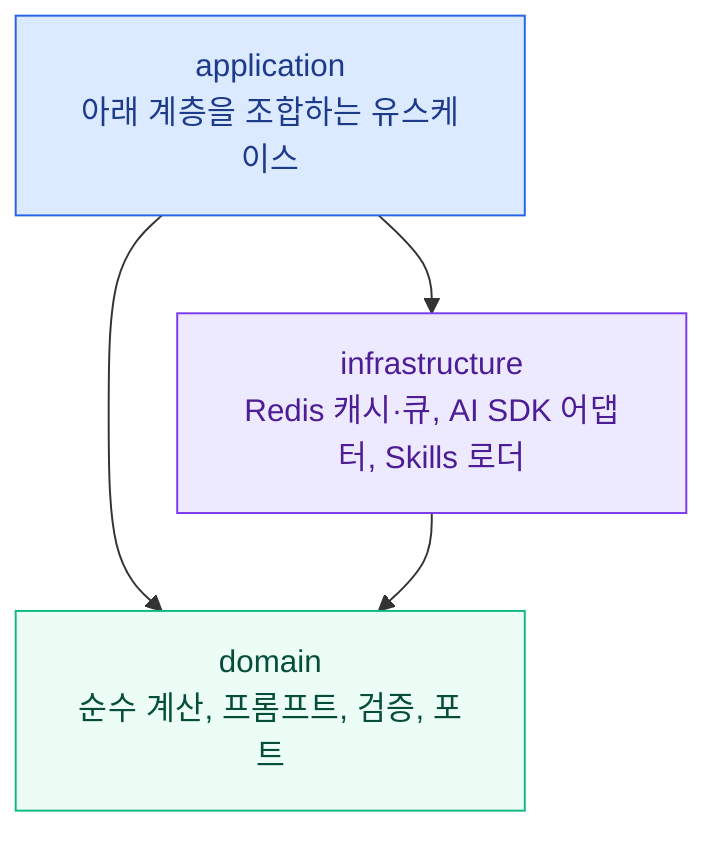

# SIGLENS CORE

<div align="center">

**SIGLENS의 분석을 담당하는 순수 TypeScript 엔진. 보조지표, 패턴, 신호, AI 분석 구성 요소를 제공합니다.**

[](./LICENSE)
[](./package.json)

[](https://siglens.io)
[](https://github.com/y0ngha/siglens)
[](./README.md)

</div>

---

## 어떤 패키지인가요

`@y0ngha/siglens-core`는 미국 주식·한국 주식·암호화폐를 위한 AI 분석 서비스 [SIGLENS](https://siglens.io)의 분석 도메인입니다. 차트가 무엇을 뜻하는지 판단하는 데 필요한 것을 모두 담고 있습니다. 보조지표를 어떻게 계산하는지, 어떤 패턴과 신호가 나타났는지, AI 프롬프트를 어떻게 구성하는지, 모델의 답변을 사용자에게 보여 주기 전에 어떻게 검증하는지가 여기에 있습니다.

UI도, React도, Next.js도 없는 순수 TypeScript 라이브러리입니다. [SIGLENS 웹 앱](https://github.com/y0ngha/siglens), 백그라운드 워커, [ai.siglens.io](https://ai.siglens.io)의 AI 에이전트가 모두 이 패키지 하나를 사용하므로, 어디서 쓰든 계산 결과와 규칙이 같습니다.

이 패키지는 주문을 넣지 않고 매수·매도를 권하지도 않습니다. 분석에 쓸 입력과 검증을 마친 분석 결과를 만들 뿐이고, 그 결과를 어떻게 쓸지는 사용하는 쪽이 정합니다.

## 할 수 있는 일

### 보조지표

가격 봉 배열 하나로 다양한 보조지표를 계산해 하나의 구조화된 결과로 돌려줍니다. 추세, 모멘텀, 변동성, 거래량 계열을 모두 다루며 이동평균, RSI, MACD, 볼린저 밴드, 일목균형표, 슈퍼트렌드, 스마트 머니 컨셉, 스퀴즈 모멘텀 등이 포함됩니다. 계산은 외부 지표 라이브러리 없이 패키지 안에서 직접 구현했습니다.

### 캔들·차트 패턴

단봉과 다봉 캔들 패턴은 봉 데이터에서 바로 감지합니다. 규모가 큰 차트 패턴은 먼저 기하학적 형태로 후보를 거른 뒤 자격 검증과 중재를 거쳐, 그럴듯한 형태만 차트나 AI 프롬프트에 올라갑니다. 추세선, 피보나치 레벨, 다이버전스, 엘리어트 파동 후보 같은 차트 오버레이도 같은 데이터에서 만들 수 있습니다.

### 신호 감지

순수 함수 감지기가 보조지표의 상태를 이름 붙은 신호로 바꿉니다. 확정된 교차와 돌파, 움직임이 완성되기 전에 나타나는 선행 신호, 눌림목, 추세 분류가 여기에 해당합니다. 여러 신호가 같은 방향을 가리키는 지점은 합류 분석으로 보여 줍니다.

### Skills 시스템

분석 기법은 코드가 아니라 frontmatter가 붙은 Markdown 파일로 작성합니다. 패키지는 이 파일을 읽고, 시장 상태에 맞게 표본을 고르고 걸러 내어 선택된 기법을 프롬프트에 넣습니다. 새 기법은 파일 하나를 추가하면 되고 계산 코드는 건드리지 않습니다. Skill 파일 자체는 사용하는 쪽에서 제공합니다.

### AI 분석 프롬프트와 검증

기술적 분석, 펀더멘털, 재무, 뉴스, 옵션, 의회 거래, 투자자 수급, 종합 분석은 물론 시장·거시경제 브리핑까지 프롬프트를 순수 함수로 구성합니다. 모델 응답은 JSON 복구, 정규화, 정합성 검사를 거치므로 형식이 깨졌거나 앞뒤가 맞지 않는 답변은 보여 주는 대신 고치거나 거부합니다. 모델 레지스트리에는 Anthropic, Google, OpenAI, DeepSeek의 지원 모델이 정리되어 있습니다.

### 분석 오케스트레이션

분석 제출, 작업 상태 조회, 취소, 캐시된 결과 읽기를 하나로 묶은 유스케이스를 제공합니다. 캐시, 동시 요청 중복 제거, 작업 큐, 재분석 쿨다운, 티어별 사용량 제한, 사용자가 직접 넣는 API 키(BYOK)까지 처리합니다. 무거운 작업은 HTTP로 외부 워커에 맡길 수도 있습니다.

### 시장 심리

주식 시장과 암호화폐 각각에 대해 여러 요인을 가중해 공포·탐욕 지수를 만들고, 백분위와 국면별 통계를 함께 계산합니다. 과거에 어떤 신호가 실제로 우위가 있었는지 확인하는 사후 검증 도구도 있습니다.

### 에이전트 구성 요소

대화형 에이전트를 위한 도구 목록, 인자 검증, 시스템 프롬프트, 대화 이력 창, 그리고 단계 상한·중단·환불을 갖춘 턴 루프를 제공합니다.

## 구조



- **domain**은 I/O도, 시계도, 환경 변수 접근도 없는 순수 TypeScript입니다. 캐시, 시세, 뉴스, 저장소처럼 외부 세계가 만족해야 할 포트도 여기서 선언합니다.
- **infrastructure**는 Upstash Redis, AI 제공사 SDK, Skills 파일 읽기처럼 바깥과 통신합니다. domain만 import할 수 있습니다.
- **application**은 위 두 계층을 엮어 처음부터 끝까지 이어지는 유스케이스를 만듭니다. 아래 계층은 application을 import하지 않습니다.

화면과 실행 환경은 사용하는 쪽이 맡고, 포트를 구현하는 데이터베이스 어댑터와 시세 조회 코드도 사용하는 쪽이 맡습니다. 공개 심볼은 단일 진입점으로만 내보내며 deep import는 지원하지 않습니다.

## 설치

GitHub Packages에 배포되어 있습니다. `@y0ngha` 스코프를 해당 레지스트리에 연결하고, `read:packages` 권한이 있는 GitHub 토큰으로 인증해야 합니다.

```yaml
# .yarnrc.yml
npmScopes:
    y0ngha:
        npmRegistryServer: 'https://npm.pkg.github.com'
        npmAuthToken: '${GITHUB_TOKEN}'
```

```bash
yarn add @y0ngha/siglens-core
```

Node.js 22 이상이 필요합니다. `@upstash/redis`는 선택적 peer dependency이며, Redis 기반 캐시·작업 큐·카운터를 쓸 때만 설치하면 됩니다.

## 개발

```bash
yarn install
yarn test        # 단위 테스트 (Vitest)
yarn typecheck   # TypeScript, 서버·브라우저 진입점
yarn lint        # ESLint
yarn build       # dist/로 컴파일
```

패키지 관리자는 Yarn만 사용합니다. `npm`과 `pnpm`은 사용하지 않습니다.

## 문서

프로젝트 문서는 한국어로 작성되어 있습니다.

| 문서 | 내용 |
|---|---|
| [SERVICE.md](./docs/SERVICE.md) | 라이브러리가 제공하는 것과 사용하는 쪽에 맡기는 것 |
| [DOMAIN.md](./docs/DOMAIN.md) | 보조지표, 패턴, 프롬프트, 비즈니스 규칙 |
| [ARCHITECTURE.md](./docs/ARCHITECTURE.md) | 계층 구조, 의존 방향, 폴더 구성 |
| [PUBLIC_API.md](./docs/PUBLIC_API.md) | 공개 API 등급과 버전 정책 |
| [API.md](./docs/API.md) | infrastructure 계층이 사용하는 외부 서비스 |
| [CONVENTIONS.md](./docs/CONVENTIONS.md) | 코딩과 테스트 규칙 |
| [FF.md](./docs/FF.md) | 설계 원칙: 가독성, 예측 가능성, 응집도, 결합도 |
| [GIT_CONVENTIONS.md](./docs/GIT_CONVENTIONS.md) | 브랜치, 커밋, PR 규칙 |

## 보안

취약점은 공개 이슈로 올리지 말고 [SECURITY.md](./SECURITY.md)의 절차를 따라 제보해 주세요.

## 면책 조항

이 라이브러리로 만든 결과는 참고용 분석일 뿐 투자 조언이 아닙니다. 특정 자산의 매수·매도를 권유하지 않으며, 투자 판단은 언제나 읽는 분의 몫입니다.

## 라이선스

[MIT License](./LICENSE) © 2026 y0ngha
