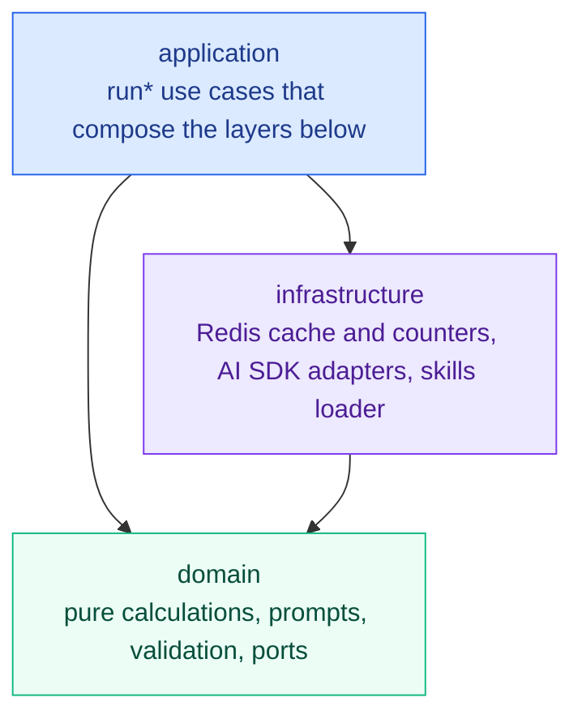

# SIGLENS CORE

<div align="center">

**TypeScript technical analysis library for stocks and crypto: indicators, candlestick and chart patterns, trading signals, and validated AI/LLM analysis.**

[](./LICENSE)
[](./package.json)

[](https://siglens.io)
[](https://github.com/y0ngha/siglens)
[](./README.ko.md)

</div>

---

`@y0ngha/siglens-core` is the open-source analysis engine behind [SIGLENS](https://siglens.io), an AI analysis service for US stocks, Korean stocks, and crypto. From a plain array of price bars it computes technical indicators (RSI, MACD, Bollinger Bands, and more), detects candlestick and chart patterns, flags trading signals, and builds a fear and greed index. It also assembles the prompts for AI analysis and checks the model's answer before anyone sees it.

> **Not investment advice. This library places no orders and has no trading features.** It produces analysis and nothing more.

## What it is

The package holds everything that decides what a chart means: how indicators are calculated, which patterns and signals are present, how an AI prompt is assembled, and how the model's answer is checked. It is a plain TypeScript library with no UI, no React, and no Next.js. The [SIGLENS web app](https://github.com/y0ngha/siglens), background workers (separate processes that run jobs outside the web server), and the AI agent at [ai.siglens.io](https://ai.siglens.io) all depend on it, so the numbers and rules stay identical wherever they are used.

## Quick start

```ts
import { calculateIndicators, detectSignals, type Bar } from '@y0ngha/siglens-core';

// Oldest bar first. `time` is a Unix timestamp in seconds.
const bars: Bar[] = [{ time: 1_735_689_600, open: 189.2, high: 191.0, low: 188.1, close: 190.4, volume: 48_200_000 } /* , ... */];

const indicators = calculateIndicators(bars); // RSI, MACD, Bollinger Bands, ... per bar
const signals = detectSignals(bars, indicators); // e.g. { type: 'golden_cross', direction, phase, detectedAt }
```

Warm-up periods are filled with `null`, so "not yet computed" is never confused with a real `0`.

## How much to trust the output

- **Numbers come from code, not from AI.** Indicators, signals, patterns, and scorecards are computed deterministically by pure functions. The AI only interprets numbers that were already calculated.
- **The AI's answer is checked.** Responses go through JSON repair, normalization, and sanity checks; an inconsistent answer is corrected or rejected rather than displayed. Examples enforced in code: support and resistance levels with a non-positive price or no stated reason are dropped, and the AI's stop-loss and take-profit prices are validated with an ATR-based fallback. A helper also flags numbers in an AI answer that appear in none of the tool results it was given.
- **It can still be wrong.** AI can misread a chart, and past signals do not guarantee future results.

## What it can do

### Technical indicators

A wide set of indicators is computed from one array of bars and returned as one structured result: moving averages, RSI, MACD, Bollinger Bands, Ichimoku, Supertrend, Smart Money Concepts, squeeze momentum, and many more across trend, momentum, volatility, and volume. The math is implemented in the package itself, without a third-party indicator library.

### Candlestick and chart patterns

Single- and multi-candle patterns (hammer, doji, engulfing, harami, and others) are detected from the bars. Larger chart patterns (head and shoulders, double and triple tops and bottoms, triangles, wedges, flags, cup and handle, and others) are first screened by geometry, then qualified and arbitrated so only plausible shapes reach the chart or the AI prompt. Trendlines, support and resistance levels, Fibonacci levels, divergences, and Elliott wave candidates can be derived from the same data.

### Signal detection

Pure detectors turn indicator state into named signals: confirmed events such as golden and death crosses, RSI overbought and oversold, MACD crosses, and Bollinger breakouts; anticipation signals that appear before a move completes, such as RSI divergence, Bollinger squeeze, and nearing support or resistance; pullbacks; and trend classification. A confluence step checks whether several signals point the same way.

### Skills

Skills are analysis techniques written as Markdown files with frontmatter instead of code. The package loads them, samples and gates them by market state, and feeds the selected ones into the prompt. A new technique is a new file, with no change to calculation code. The skill files themselves are supplied by the consumer.

### AI analysis prompts and validation

Prompts are built as pure functions for technical, fundamental, financial, news, options (derivatives), US congressional trading, investor flows, and overall analysis, plus market and macro briefings. A model registry covers Anthropic, Google, OpenAI, and DeepSeek.

### Analysis use cases

In-process `run*` functions (`runAnalysis`, `runOverallAnalysis`, `runNewsAnalysis`, `runBriefing`, and others) call the model directly and return the finished result. They handle caching, in-flight de-duplication of identical requests, tier gating and usage limits, and BYOK. A *tier* is the product plan (free, member, or pro); *BYOK* (bring your own key) means the user supplies their own AI API key. A re-analysis cooldown (5 minutes per symbol and timeframe) is available as a helper for the consumer to apply. There is no job queue and no external worker.

### Market sentiment

A fear and greed index scores 0 to 100 in five stages (extreme fear, fear, neutral, greed, extreme greed). It is available per stock, for the US market overall, and for crypto, with percentile and regime statistics. Helpers also record each stay in an extreme zone (when it started and ended, how many sessions it lasted, and its peak score) and compare a stock's score with the market's on the same day. KOSPI and KOSDAQ tick-size rounding is included for Korean price levels.

### Agent building blocks

For the conversational agent, the package supplies the tool catalog, argument validation, the system prompt, history windowing, and a turn loop with step limits, cancellation, and refunds.

## Architecture



- **domain** is pure TypeScript with no I/O, no clock, and no environment access. It declares the ports (cache, market data, news, repositories, and so on) that the outside world must satisfy.
- **infrastructure** talks to the outside: Upstash Redis, AI provider SDKs, and the filesystem for skills. It may import only from domain.
- **application** composes the two into end-to-end use cases. Nothing below it imports it.

There are two entry points. The server entry (`dist/index.js`) exports the full API. Bundlers pick the browser entry (`dist/index.client.js`) through the `browser` export condition; it is a pure, browser-safe subset with no application or infrastructure runtime code. Deep imports are not supported. Consumers own presentation, database adapters, and market data fetchers that implement the ports.

## Installation

The package is published to GitHub Packages. Map the `@y0ngha` scope to that registry and authenticate with a GitHub token that has the `read:packages` scope. Every install needs the token, including CI.

```yaml
# .yarnrc.yml
npmScopes:
    y0ngha:
        npmRegistryServer: 'https://npm.pkg.github.com'
        npmAuthToken: '${GITHUB_TOKEN}'
```

```ini
# .npmrc
@y0ngha:registry=https://npm.pkg.github.com
//npm.pkg.github.com/:_authToken=${GITHUB_TOKEN}
```

```bash
yarn add @y0ngha/siglens-core
```

Node.js 22 or later is required. The AI provider SDKs and `@upstash/redis` are optional peer dependencies, so install only what you use: `@anthropic-ai/sdk` for Claude, `@google/genai` for Gemini, `openai` for ChatGPT and DeepSeek, and `@upstash/redis` for the Redis-backed cache or counters. Importing the package never loads an SDK; calling a model whose SDK is missing fails with an install hint.

## Runtime configuration

**Market data is not included.** Implement the `MarketDataProvider` port (`getBars`, `getQuote`) with your own data source and pass it as `marketDataProvider` to the use cases that fetch bars (such as `runAnalysis`).

The infrastructure layer reads these environment variables, only when the matching feature is used:

| Variable | Used for | Required |
|---|---|---|
| `ANTHROPIC_API_KEY`, `GEMINI_API_KEY`, `OPENAI_API_KEY`, `DEEPSEEK_API_KEY` | Server-owned AI keys, read when a model of that provider is called without a user key (BYOK) | Only for providers you call with a server key |
| `UPSTASH_REDIS_REST_URL`, `UPSTASH_REDIS_REST_TOKEN` | Redis cache, usage counters, and the re-analysis cooldown; `createCacheProvider()` returns `null` when unset. Use cases also accept your own `CacheProvider` (or `null` for no cache) through the `cache` option | Optional |
| `UPSTASH_REDIS_REST_READONLY_TOKEN` | Read-only token for cache reads, if you split credentials | Optional |
| `FMP_API_KEY` | Read by `readFmpConfig()` / `tryReadFmpConfig()` | Optional |

Skill files are Markdown with frontmatter, loaded from a `skills/` directory under the process working directory. The required fields and format are in [DOMAIN.md](./docs/DOMAIN.md).

## Development

```bash
yarn install
yarn test        # unit tests (Vitest)
yarn typecheck   # TypeScript, server and browser entry points
yarn lint        # ESLint
yarn build       # compile to dist/
```

The project uses Yarn only. `npm` and `pnpm` are not used.

## Documentation

Project documentation is mostly written in Korean, with some parts in English.

| Document | Contents |
|---|---|
| [SERVICE.md](./docs/SERVICE.md) | What the library provides and what it leaves to consumers |
| [DOMAIN.md](./docs/DOMAIN.md) | The actual indicator formulas, thresholds, patterns, prompts, and business rules |
| [ARCHITECTURE.md](./docs/ARCHITECTURE.md) | Layers, dependency direction, and folder layout |
| [PUBLIC_API.md](./docs/PUBLIC_API.md) | Developer reference: public API tiers, export inventory, versioning policy |
| [API.md](./docs/API.md) | External services used by the infrastructure layer |
| [CONVENTIONS.md](./docs/CONVENTIONS.md) | Coding and testing conventions |
| [FF.md](./docs/FF.md) | Design principles: readability, predictability, cohesion, coupling |
| [GIT_CONVENTIONS.md](./docs/GIT_CONVENTIONS.md) | Branch, commit, and pull request rules |
| [CHANGELOG.md](./CHANGELOG.md) | Release history |

## Security

Please do not report a vulnerability in a public issue. Follow the process in [SECURITY.md](./SECURITY.md).

## Disclaimer

Output built with this library is analysis for information only. It is not investment advice, and nothing here recommends buying or selling any asset. Investment decisions remain your own.

## License

[MIT License](./LICENSE) © 2026 y0ngha
