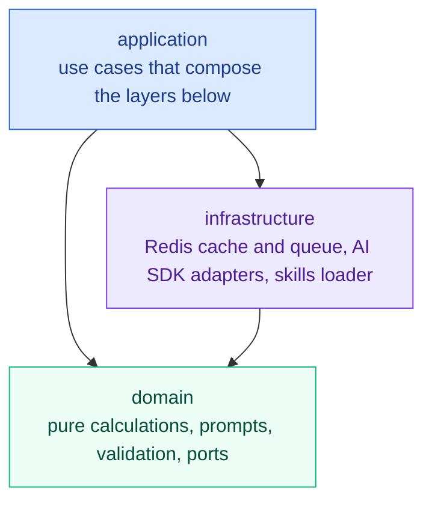

# SIGLENS CORE

<div align="center">

**The pure TypeScript analysis engine behind SIGLENS: indicators, patterns, signals, and AI analysis building blocks.**

[](./LICENSE)
[](./package.json)

[](https://siglens.io)
[](https://github.com/y0ngha/siglens)
[](./README.ko.md)

</div>

---

## What it is

`@y0ngha/siglens-core` is the analysis domain of [SIGLENS](https://siglens.io), an AI analysis service for US stocks, Korean stocks, and crypto. It holds everything that decides what a chart means: how indicators are calculated, which patterns and signals are present, how an AI prompt is assembled, and how the model's answer is checked before anyone sees it.

It is a plain TypeScript library with no UI, no React, and no Next.js. The [SIGLENS web app](https://github.com/y0ngha/siglens), background workers, and the AI agent at [ai.siglens.io](https://ai.siglens.io) all depend on the same package, so the numbers and rules stay identical wherever they are used.

This package never places an order and never makes a recommendation. It produces analysis inputs and validated analysis results; what to do with them is up to the consumer.

## What it can do

### Technical indicators

A wide set of indicators is computed from a single array of price bars and returned as one structured result. It covers trend, momentum, volatility, and volume: moving averages, RSI, MACD, Bollinger Bands, Ichimoku, Supertrend, Smart Money Concepts, squeeze momentum, and many more. All of the math is implemented in the package itself, without a third-party indicator library.

### Candle and chart patterns

Single- and multi-candle patterns are detected directly from the bars. Larger chart patterns are first screened by geometry, then qualified and arbitrated so that only plausible shapes reach the chart or the AI prompt. Chart overlays such as trendlines, Fibonacci levels, divergences, and Elliott wave candidates can be derived from the same data.

### Signal detection

Pure detectors turn indicator state into named signals: confirmed crossovers and breakouts, anticipation signals that appear before a move completes, pullbacks, and trend classification. A confluence step shows where several signals agree.

### Skills system

Analysis techniques are written as Markdown files with frontmatter, not as code. The package loads these files, samples and gates them by market state, and feeds the selected techniques into the prompt. A new technique can be added by adding a file, with no change to calculation code. The skill files themselves are supplied by the consumer.

### AI analysis prompts and validation

Prompts are built as pure functions for technical, fundamental, financial, news, options, congressional trading, investor flows, and overall analysis, as well as for market and macro briefings. Model responses go through JSON repair, normalization, and sanity checks, so a malformed or inconsistent answer is corrected or rejected rather than displayed. A model registry describes each supported model, covering Anthropic, Google, OpenAI, and DeepSeek.

### Analysis orchestration

Ready-made use cases tie the pieces together: submit an analysis, poll its job, cancel it, and read a cached result. They handle caching, in-flight de-duplication, a job queue, re-analysis cooldowns, usage limits by tier, and user-supplied API keys (BYOK). Heavy work can be delegated to an external worker over HTTP.

### Market sentiment

Fear and greed indices are built from weighted factors for the equity market and for crypto, with percentile and regime statistics. Forward-looking validation helpers measure whether a signal has had an edge in the past.

### Agent building blocks

For the conversational agent, the package supplies the tool catalog, argument validation, the system prompt, history windowing, and a turn loop with step limits, cancellation, and refunds.

## Architecture



- **domain** is pure TypeScript with no I/O, no clock, and no environment access. It also declares the ports (cache, market data, news, repositories, and so on) that the outside world must satisfy.
- **infrastructure** talks to the outside: Upstash Redis, AI provider SDKs, and the filesystem for skills. It may import only from domain.
- **application** composes the two into end-to-end use cases. Nothing below it imports it.

Consumers own presentation and runtime concerns, as well as the database adapters and market data fetchers that implement the ports. Everything public is exported from a single entry point; deep imports are not supported.

## Installation

The package is published to GitHub Packages. Map the `@y0ngha` scope to that registry and authenticate with a GitHub token that has the `read:packages` scope.

```yaml
# .yarnrc.yml
npmScopes:
    y0ngha:
        npmRegistryServer: 'https://npm.pkg.github.com'
        npmAuthToken: '${GITHUB_TOKEN}'
```

```bash
yarn add @y0ngha/siglens-core
```

Node.js 22 or later is required. `@upstash/redis` is an optional peer dependency: install it only if you use the Redis-backed cache, job queue, or counters.

## Development

```bash
yarn install
yarn test        # unit tests (Vitest)
yarn typecheck   # TypeScript, server and browser entry points
yarn lint        # ESLint
yarn build       # compile to dist/
```

The project uses Yarn only. `npm` and `pnpm` are not used.

## Documentation

Project documentation is written in Korean.

| Document | Contents |
|---|---|
| [SERVICE.md](./docs/SERVICE.md) | What the library provides and what it leaves to consumers |
| [DOMAIN.md](./docs/DOMAIN.md) | Indicators, patterns, prompts, and business rules |
| [ARCHITECTURE.md](./docs/ARCHITECTURE.md) | Layers, dependency direction, and folder layout |
| [PUBLIC_API.md](./docs/PUBLIC_API.md) | Public API tiers and versioning policy |
| [API.md](./docs/API.md) | External services used by the infrastructure layer |
| [CONVENTIONS.md](./docs/CONVENTIONS.md) | Coding and testing conventions |
| [FF.md](./docs/FF.md) | Design principles: readability, predictability, cohesion, coupling |
| [GIT_CONVENTIONS.md](./docs/GIT_CONVENTIONS.md) | Branch, commit, and pull request rules |

## Security

Please do not report a vulnerability in a public issue. Follow the process in [SECURITY.md](./SECURITY.md).

## Disclaimer

Output built with this library is analysis for information only. It is not investment advice, and nothing here recommends buying or selling any asset. Investment decisions remain your own.

## License

[MIT License](./LICENSE) © 2026 y0ngha
